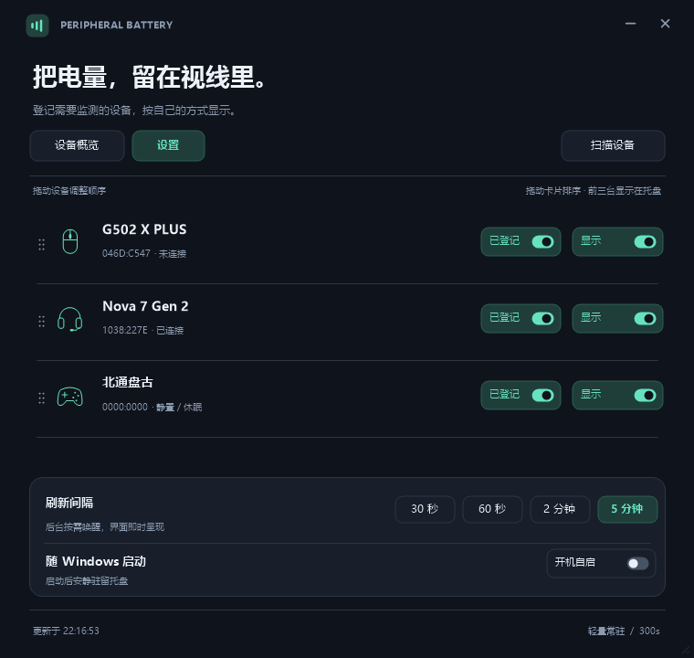

<h1 align="center">Peripheral Battery</h1>

把无线外设的电量，留在视线里。

Windows 11 x64 · C++20 / Win32 · MIT · 便携 ZIP

<a href="https://github.com/Axiomerator/peripheral-battery-checker/releases/latest">下载便携版</a> · <a href="docs/protocols.md">设备协议</a> · <a href="docs/development.md">构建与开发</a>

轻量的 Windows 托盘电量监视器，面向指定型号的 2.4 GHz 无线鼠标、键盘、耳机和手柄。使用系统原生窗口与 GDI+ 绘图，无需安装运行时。

## 一眼看到电量

- 托盘悬停显示缓存速览，单击固定速览，双击打开控制中心；右键可设置、刷新或退出。
- 显示电量百分比、充电和静置状态；设备休眠或断开时保留本次运行中的最后有效读数。
- 拖动卡片或六点手柄排序，三个列表同步保存顺序；托盘从左到右显示前三台已登记且开启展示的设备。
- 设备列表可滚动，窗口可缩放；刷新间隔、开机自启固定在设置页底部。

## 下载与使用

1. 在 [Releases](https://github.com/Axiomerator/peripheral-battery-checker/releases) 下载 **PeripheralBattery-版本-windows-x64.zip**。
2. 解压到有写入权限的固定目录，运行 PeripheralBattery.exe。
3. 在设置中扫描设备，按需启用“登记”和“显示”。

ZIP 中包含程序、README.txt 和 LICENSE.txt；首次运行在 EXE 旁创建 data/settings.ini。开机自启默认关闭。

自启通过当前用户的 Windows 启动文件夹快捷方式生效，登录后仅驻留托盘，关闭开关会移除启动项。可用 Win+R → shell:startup 直接核对；完整机制和无需重启的检查步骤见 [自启说明](docs/autostart.md)。

升级时先从托盘退出程序，再替换 EXE，保留原有 data 文件夹。移动程序目录后，重新关闭再开启自启，以更新启动路径。

> GitHub 自动生成的 Source code (zip) 是源码。直接运行请选择带 windows-x64 的便携 ZIP。

已验证环境为 Windows 11 x64。Windows 10 和 ARM64 尚未实测。

## 设备支持

按设备型号、接收器 VID/PID 和厂商 HID 协议读取电量。

| 设备 | VID:PID | 验证状态 |
| --- | --- | --- |
| Logitech G502 X PLUS / LIGHTSPEED 接收器 | 046D:C547 | 本机真机通过 |
| SteelSeries Nova 7 Gen 2 | 1038:227E | 本机真机通过 |
| 北通盘古 BTP-PG01A | 20BC:5162 | 本机真机通过 |
| MCHOSE K99 V3 / 2.4 GHz 接收器 | 3837:3033 | 本机实测电量和充电切换，另核对 USB 产品名 |
| Logitech PRO 2 LIGHTSPEED | 046D:C543 / C09A | 工位用户反馈电量与充电可读，连接路径待逐一核对 |
| G502 X PLUS USB 直连 | 046D:C095 | 实验性备用路径，未真机验证 |

同 PID 的多个同型号接收器目前共用型号登记。具体接口、报文字段和来源见 [协议记录](docs/protocols.md) 与 [参考资料](docs/references.md)。

## 静置与休眠

鼠标约 15 秒没有对应设备活动后暂停主动查询，保留电量并显示“静置”；重新操作后延迟约 0.5 秒补读。静置是活动判断，不是固件确认的睡眠标志。只读取 Raw Input 的设备标识，不读取按键或移动内容。

耳机通过被动状态通知识别已知离线；盘古厂商接口消失时保留状态。启动时若设备已休眠且本次没有有效读数，会先显示“—”。手动刷新也遵守已知静置设备的暂停。

## 操作

| 操作 | 效果 |
| --- | --- |
| 托盘悬停 / 单击 / 双击 | 速览 / 固定或收起速览 / 控制中心 |
| X / Esc | 收起窗口并保留托盘；拖动中 Esc 优先取消排序 |
| Ctrl+R / Ctrl+, | 刷新 / 设置 |
| Tab、Space、Enter | 切换焦点、操作按钮 |
| 滚轮、滚动条、Page Up / Down、Home / End | 滚动设备列表 |
| 拖动卡片至列表上下边缘 | 自动滚动并调整顺序 |

## 资源占用

C++20 / Win32 / GDI+，静态 C++ 运行库，后台按需等待，隐藏时不持续绘制。

本机曾测得 EXE 约 0.76 MiB，总工作集约为托盘 13.6 MiB、主窗口 19.4 MiB。总工作集包含 Windows 共享库，随设备、字体缓存和交互变化，详见 [验证记录](docs/validation.md)。

## 从源码构建

安装 Visual Studio 2022 / Build Tools 的“使用 C++ 的桌面开发”（含 Windows SDK）及 CMake 3.24 或更高版本。

    powershell -ExecutionPolicy Bypass -File tools/build.ps1

输出为 dist/PeripheralBattery.exe；脚本会运行协议、界面与自启隔离回归测试。生成图标时才需要 Python，普通构建和运行不需要 Python。

生成经过构建、测试的便携 ZIP：

    powershell -ExecutionPolicy Bypass -File tools/package.ps1

输出位于 releases/。打包使用独立构建目录，不覆盖日常运行的 dist/ 程序或个人设置。

## 维护与反馈

这是个人低频维护项目。问题和设备支持请求请提交 [Issue](https://github.com/Axiomerator/peripheral-battery-checker/issues)，注明系统、软件版本、设备型号和 VID/PID；新增协议需要可验证的报文依据。提交诊断材料前可去掉个人路径及设备序列号。

维护流程见 [发布说明](docs/releasing.md)。推送 main 会构建并测试；推送版本标签会生成带 ZIP 的 Release 草稿，确认后手动发布。

## 许可证与致谢

[MIT](LICENSE) © 2026 Axiomerator。

源码和图形资源独立编写；参考了 2.4G-battery-viewer、ChargeDock、Logitech HID++ 文档及相关协议研究。项目链接、协议依据及素材说明见 [参考资料](docs/references.md)。
